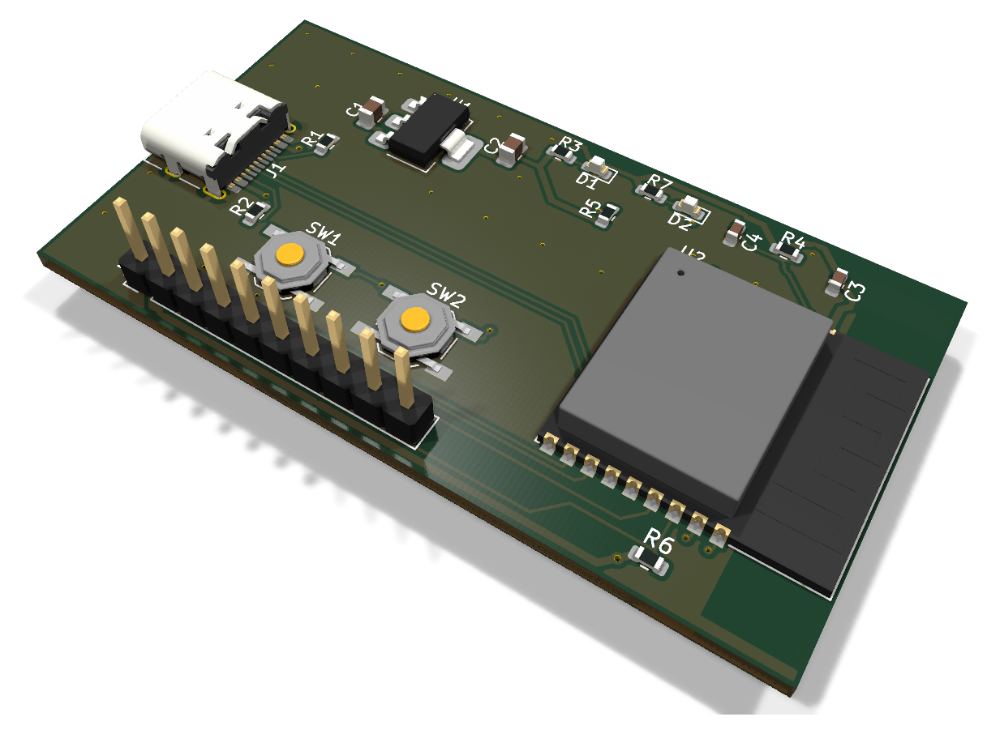
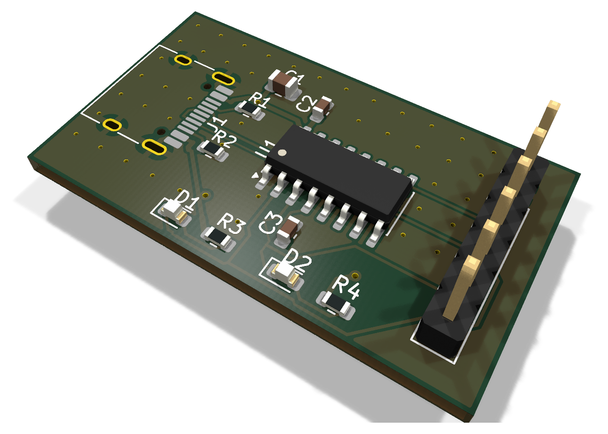
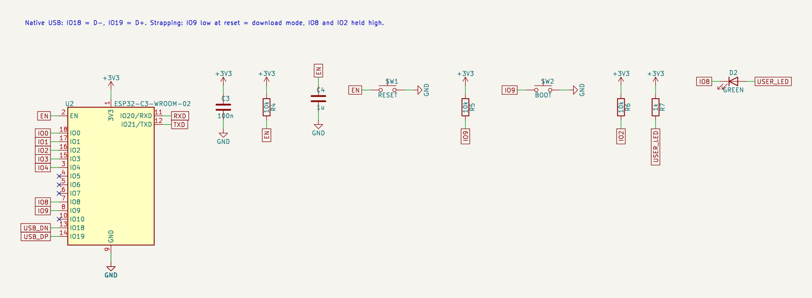
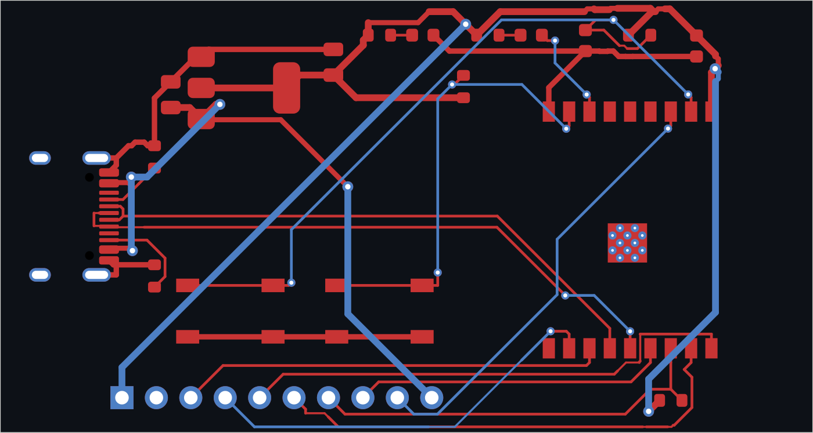

<p align="center">
  <picture>
    <source media="(prefers-color-scheme: dark)" srcset="assets/logo-dark.svg" />
    
  </picture>
</p>

<p align="center"><b>Describe a circuit. Get a routed, DRC-clean KiCad board and a JLCPCB order.</b></p>

<p align="center">
  <a href="https://github.com/atillaertas1/tamga-pcb/actions/workflows/ci.yml"></a>
  &nbsp;
  <a href="LICENSE"></a>
  &nbsp;
  
  &nbsp;
  
  &nbsp;
  
  &nbsp;
  <a href="README.tr.md"></a>
</p>

<p align="center">
  
</p>
<p align="center"><sub>An ESP32-C3 board with USB-C, a 3.3 V regulator, reset/boot buttons and a GPIO header: schematic,
placement, routing, ground pour, DRC and fab files all made through tamga-pcb's tools.
<a href="examples/esp32c3-devboard">Rebuild it yourself</a>.</sub></p>

**tamga-pcb** gives Claude Code the whole KiCad workflow as 20 compact tools. You describe the board in plain
words; Claude writes a short circuit spec, tamga-pcb turns it into a schematic and a PCB, places the parts,
routes the board with Freerouting, pours ground, loops on DRC until it is clean, and exports Gerbers, BOM and
pick-and-place for JLCPCB. Every LCSC part is checked against its real pinout on the way, and Claude never reads
raw KiCad files: tools answer in one-line summaries, so a whole board fits comfortably in the context.

```
> Make me an ESP32-C3 board powered from USB-C, with reset and boot buttons, a user LED
  and a GPIO header. Keep it under 60 x 32 mm and get it ready for JLCPCB.
```

## Examples

<table>
  <tr>
    <td width="50%" align="center"><a href="examples/ch340-usb-uart"></a></td>
    <td width="50%" align="center"><a href="examples/esp32c3-devboard"></a></td>
  </tr>
  <tr>
    <td><b><a href="examples/ch340-usb-uart">CH340C USB-C to UART adapter</a></b><br/><sub>Made by Claude Code from <b>one
    prompt</b>, unattended: 35 × 20 mm, DRC clean, fab files. <b>3 min, 48 tool calls, about $0.51</b> with Sonnet 5.5,
    measured. <a href="examples/ch340-usb-uart/SESSION.md">Session report</a></sub></td>
    <td><b><a href="examples/esp32c3-devboard">ESP32-C3 USB-C dev board</a></b><br/><sub>60 × 32 mm, 19 parts, reset/boot,
    native USB. Rebuilt end to end by a script through the same tools; the reference for the images above.</sub></td>
  </tr>
</table>

Token counts, cost, time and what the first attempt taught us: [docs/BENCHMARKS.md](docs/BENCHMARKS.md). On the same prompt with the same model, the most-starred KiCad MCP server also finished the board; tamga-pcb used 48 % less money, 43 % fewer tool calls and 40 % less peak context (one run each, [details](docs/BENCHMARKS.md#against-another-kicad-mcp-server)).

## Install

Run this inside Claude Code:

```
/plugin install tamga-pcb --marketplace atillaertas1/tamga-pcb
```

You need **[KiCad 10](https://www.kicad.org/download/)** and **[uv](https://docs.astral.sh/uv/)**; autorouting
also needs **Java 25+**. tamga-pcb finds KiCad on its own on Linux, macOS and Windows, builds its Python
environment on first start and downloads Freerouting the first time it routes. No API keys.

<details>
<summary>Older Claude Code versions</summary>

```
/plugin marketplace add atillaertas1/tamga-pcb
/plugin install tamga-pcb@tamga-pcb
```

</details>

<details>
<summary>Other MCP clients</summary>

Clone the repo and register this as a stdio server:

```bash
uv run --directory /path/to/tamga-pcb --extra lcsc tamga
```

The design workflow the plugin loads as a skill lives in [`skills/pcb-design/SKILL.md`](skills/pcb-design/SKILL.md);
give it to your agent as instructions.

</details>

<details>
<summary>Something not found?</summary>

Ask Claude to *run the tamga doctor*. It checks KiCad, its Python, the libraries, Java and the network, and names the
environment variable to set for anything it cannot find: `TAMGA_KICAD_CLI`, `TAMGA_KICAD_PYTHON`,
`TAMGA_SYMBOL_DIR`, `TAMGA_FOOTPRINT_DIR`, `TAMGA_JAVA`, `FREEROUTING_JAR`.

</details>

## From a spec to a board

The single source of truth is a short `<name>.circuit.json`: parts, footprints, LCSC numbers and which net each
pin goes to. Claude writes it, tamga-pcb does the rest.

```json
{"ref": "U2", "symbol": "RF_Module:ESP32-C3-WROOM-02", "lcsc": "C2934560",
 "footprint": "RF_Module:ESP32-C3-WROOM-02", "sheet": "MCU",
 "pins": {"1": "+3V3", "2": "EN", "13": "USB_DN", "14": "USB_DP", "9": "GND"}}
```

<table>
  <tr>
    <td width="50%"></td>
    <td width="50%"></td>
  </tr>
  <tr>
    <td align="center"><sub>Generated schematic, one sheet per function</sub></td>
    <td align="center"><sub>Autorouted copper before the ground pour</sub></td>
  </tr>
</table>

## How it works

1. **Spec → schematic.** `sync_design` writes the `.kicad_sch` (functional sheets, power symbols, notes,
   deterministic UUIDs), exports the netlist with `kicad-cli` and checks it against the spec. A wrong pin name or a
   missing pad writes nothing and lists the valid pins.
2. **Check the real parts.** Each LCSC number is compared with the part's EasyEDA pinout. A swapped LED or the wrong
   symbol variant shows up here, not on the assembled board.
3. **Schematic → PCB.** The board is updated from the netlist like KiCad's *Update PCB*, keeping placement, then ERC
   and a schematic↔PCB parity check run.
4. **Place and route.** Claude places the parts in one batch, widens power nets with netclasses, hand-routes critical
   nets with `route_net` (locked), and lets Freerouting route the rest headlessly.
5. **Pour and verify.** A two-layer ground pour with stitching vias, then `run_drc` until it says `CLEAN`, with the
   violations grouped by type and located.
6. **Order.** `export_fab` writes Gerbers, drill files, a BOM and a CPL in JLCPCB's format and lists parts without an
   LCSC code.

The [pcb-design skill](skills/pcb-design/SKILL.md) carries the loop, the placement checklist and JLCPCB's limits, so
Claude follows the same steps every time.

## The tools

| Tool | What it does |
| --- | --- |
| `sync_design` | Spec → schematic + PCB, netlist and pinout checks, ERC, parity. Edits go through small patches. |
| `find_symbol`, `get_symbol`, `find_footprint` | Search KiCad's libraries; confirm pin names and that footprint pads match. |
| `search_parts`, `import_lcsc_part` | JLCPCB/LCSC stock and price, basic parts first; bring in parts KiCad doesn't have. |
| `board_summary`, `get_footprint` | One line per footprint and net, pad positions. No raw `.kicad_pcb` in the context. |
| `place_footprints` | Move, rotate and flip many footprints in one call. |
| `set_netclass`, `route_net` | Track widths per net class; guided, locked routes for critical nets. |
| `autoroute` | Freerouting without its GUI, with progress and a timeout that reports where it stopped. |
| `add_copper_zone`, `fill_zones` | Ground pours with stitching vias. |
| `run_drc`, `run_erc` | Violations grouped by type with example locations: 300 violations fit in about 1 KB. |
| `render_board` | PNG of the board for a visual check. |
| `export_fab` | Gerbers, drill, BOM and CPL for JLCPCB. |
| `import_board` | Bring in Altium, Eagle, PADS or CADSTAR boards. |

## Why it is cheap on tokens

| Choice | Effect |
| --- | --- |
| 20 tools with short descriptions | all tool schemas together ≈ 3.3k tokens (13.3k characters, measured) |
| Small answers | in the [CH340 run](examples/ch340-usb-uart/SESSION.md) all 48 tool results together were ≈ 4.2k tokens, about 350 characters per call |
| No raw KiCad files, one line per footprint | a 7-part board summary is about 900 characters |
| DRC/ERC grouped by type, three example locations | 300 violations → about 1 KB |
| Workflow in a skill | loaded only when you work on a PCB |

## Under the hood

- **pcbnew runs in a worker process** in KiCad's own Python; it can crash without taking the server down.
- **File based**, not KiCad's IPC API: it works without the KiCad window open, and in CI.
- **Freerouting through pcbnew's DSN/SES export**, because `kicad-cli` 10 has none.
- **Self-contained projects:** non-stock libraries are copied into `<project>/lib/`, so a project folder can be zipped
  and shared as is.

## Development

```bash
git clone https://github.com/atillaertas1/tamga-pcb && cd tamga-pcb
uv sync --extra lcsc
uv run pytest -q          # KiCad-dependent tests are skipped when KiCad is not installed
claude --plugin-dir .     # run Claude Code with your working copy as the plugin
```

The example board is rebuilt end to end by `uv run python examples/esp32c3-devboard/build.py`. Changes are listed in
the [changelog](CHANGELOG.md).

## Roadmap

- [ ] Live editing in an open KiCad through its IPC API
- [ ] Hierarchical pins on sheet symbols, tidier power-sheet layout
- [ ] Alternative routers (DeepPCB, Quilter)
- [ ] ngspice simulation of analog blocks

## The name

A *tamga* is the seal Turkic clans stamped onto stone, metal and coins: a mark pressed permanently into a surface,
much like a circuit etched into copper.

## License

MIT, see [LICENSE](LICENSE). **The boards you make are entirely yours**; no tool's license carries over to its output.
Optional parts are installed separately under their own licenses: easyeda2kicad (AGPL-3.0, the `lcsc` extra, run as a
separate process) and Freerouting (GPL-3.0, a separate jar downloaded on first use). KiCad is GPL-3.0.
