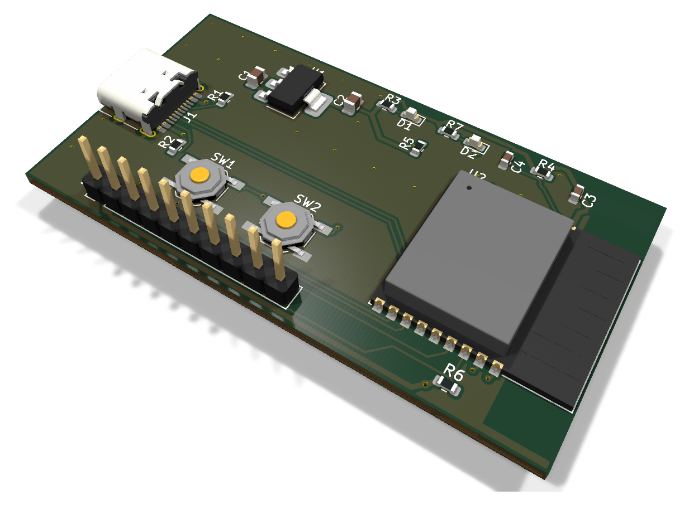
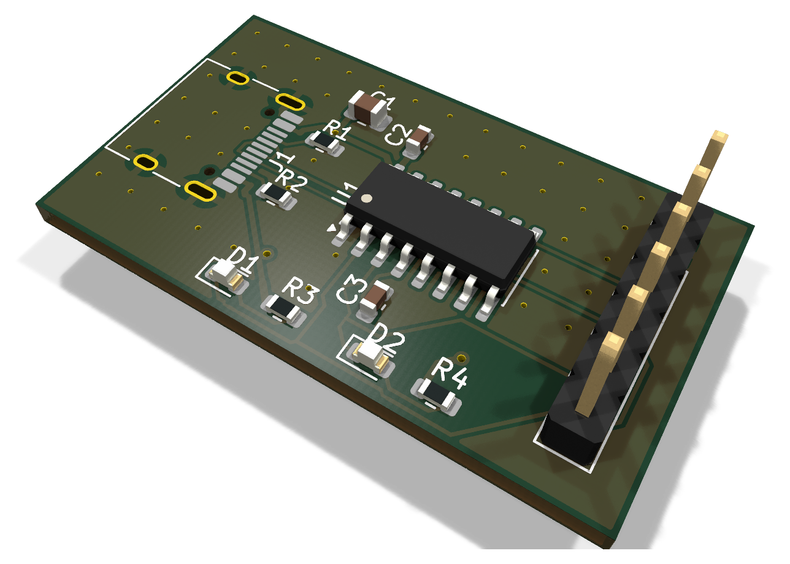
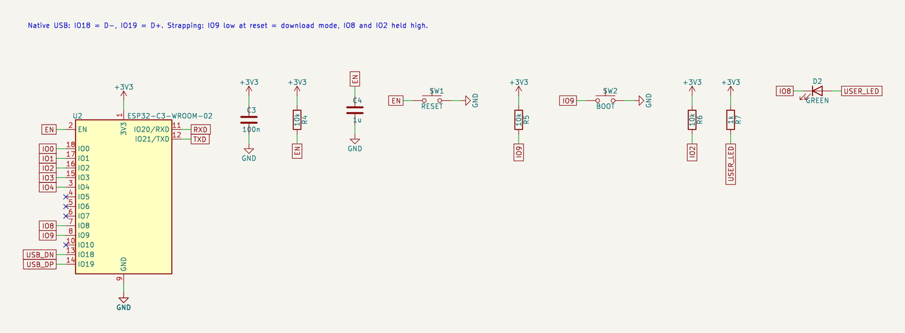
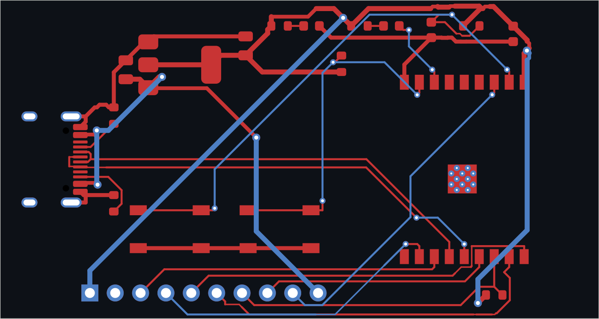

<p align="center">
  <picture>
    <source media="(prefers-color-scheme: dark)" srcset="assets/logo-dark.svg" />
    
  </picture>
</p>

<p align="center"><b>Devreyi anlat. Rotalanmış, DRC temiz bir KiCad kartı ve JLCPCB siparişi al.</b></p>

<p align="center">
  <a href="https://github.com/atillaertas1/tamga-pcb/actions/workflows/ci.yml"></a>
  &nbsp;
  <a href="LICENSE"></a>
  &nbsp;
  
  &nbsp;
  
  &nbsp;
  
  &nbsp;
  <a href="README.md"></a>
</p>

<p align="center">
  
</p>
<p align="center"><sub>USB-C, 3.3 V regülatör, reset/boot butonları ve GPIO header'lı bir ESP32-C3 kartı: şematik, yerleşim,
rota, GND dökümü, DRC ve üretim dosyaları tamamen tamga-pcb araçlarıyla yapıldı.
<a href="examples/esp32c3-devboard">Kendin yeniden üret</a>.</sub></p>

**tamga-pcb**, KiCad iş akışının tamamını Claude Code'a 21 sade araç olarak verir. Kartı düz cümlelerle
anlatırsın; Claude kısa bir devre tanımı yazar, tamga-pcb bundan şematik ve PCB üretir, parçaları yerleştirir,
Freerouting ile rotalar, GND döker, DRC temiz çıkana kadar döner ve JLCPCB için Gerber, BOM ve dizgi dosyasını
çıkarır. Yol boyunca her LCSC parçası gerçek pin dizilimiyle karşılaştırılır; Claude ham KiCad dosyası okumaz,
araçlar tek satırlık özetlerle cevap verir.

```
> USB-C'den beslenen, reset ve boot butonlu, kullanıcı LED'li ve GPIO header'lı bir ESP32-C3 kartı yap.
  60 x 32 mm'yi geçmesin, JLCPCB'ye hazır olsun.
```

## Örnekler

<table>
  <tr>
    <td width="50%" align="center"><a href="examples/ch340-usb-uart"></a></td>
    <td width="50%" align="center"><a href="examples/esp32c3-devboard"></a></td>
  </tr>
  <tr>
    <td><b><a href="examples/ch340-usb-uart">CH340C USB-C → UART adaptörü</a></b><br/><sub>Claude Code <b>tek prompt</b>tan,
    kimse karışmadan yaptı: 35 × 20 mm, DRC temiz, üretim dosyaları hazır. Sonnet 5.5 ile <b>3 dk, 48 araç çağrısı, ~0,51 $</b>,
    ölçülmüş. <a href="examples/ch340-usb-uart/SESSION.md">Oturum raporu</a></sub></td>
    <td><b><a href="examples/esp32c3-devboard">ESP32-C3 USB-C geliştirme kartı</a></b><br/><sub>60 × 32 mm, 19 parça,
    reset/boot, yerel USB. Aynı araçlarla bir script baştan sona üretir; yukarıdaki görsellerin kaynağı.</sub></td>
  </tr>
</table>

Token, maliyet, süre ve ilk denemenin öğrettikleri: [docs/BENCHMARKS.md](docs/BENCHMARKS.md). Aynı prompt ve aynı modelle en çok yıldızlı KiCad MCP sunucusu da kartı bitirdi; tamga-pcb %48 daha az maliyet, %43 daha az araç çağrısı ve %40 daha küçük en yüksek bağlamla yaptı (her biri tek koşu, [ayrıntılar](docs/BENCHMARKS.md#against-another-kicad-mcp-server)).

## Kurulum

Claude Code içinde:

```
/plugin install tamga-pcb --marketplace atillaertas1/tamga-pcb
```

Gerekenler: **[KiCad 10](https://www.kicad.org/download/)** ve **[uv](https://docs.astral.sh/uv/)**; autoroute için
**Java 25+**. tamga-pcb KiCad'i Linux, macOS ve Windows'ta kendisi bulur, ilk açılışta Python ortamını kurar ve ilk
rotada Freerouting'i indirir. API anahtarı gerekmez.

<details>
<summary>Eski Claude Code sürümleri</summary>

```
/plugin marketplace add atillaertas1/tamga-pcb
/plugin install tamga-pcb@tamga-pcb
```

</details>

<details>
<summary>Başka MCP istemcileri</summary>

Repoyu klonla ve bunu stdio sunucusu olarak ekle:

```bash
uv run --directory /yol/tamga-pcb --extra lcsc tamga
```

Plugin'in skill olarak yüklediği iş akışı [`skills/pcb-design/SKILL.md`](skills/pcb-design/SKILL.md) dosyasında;
agent'ına talimat olarak ver.

</details>

<details>
<summary>Bir şey bulunamadı mı?</summary>

Claude'a *tamga doctor'ı çalıştır* de. KiCad'i, Python'unu, kütüphaneleri, Java'yı ve ağı kontrol eder; bulamadığı
her şey için ayarlanacak ortam değişkenini söyler: `TAMGA_KICAD_CLI`, `TAMGA_KICAD_PYTHON`, `TAMGA_SYMBOL_DIR`,
`TAMGA_FOOTPRINT_DIR`, `TAMGA_JAVA`, `FREEROUTING_JAR`.

</details>

## Tanımdan karta

Tek doğruluk kaynağı kısa bir `<ad>.circuit.json`: parçalar, footprint'ler, LCSC kodları ve her pinin bağlandığı net.
Claude yazar, gerisini tamga-pcb yapar.

```json
{"ref": "U2", "symbol": "RF_Module:ESP32-C3-WROOM-02", "lcsc": "C2934560",
 "footprint": "RF_Module:ESP32-C3-WROOM-02", "sheet": "MCU",
 "pins": {"1": "+3V3", "2": "EN", "13": "USB_DN", "14": "USB_DP", "9": "GND"}}
```

<table>
  <tr>
    <td width="50%"></td>
    <td width="50%"></td>
  </tr>
  <tr>
    <td align="center"><sub>Üretilen şematik, her işlev ayrı sayfada</sub></td>
    <td align="center"><sub>GND dökümünden önce otomatik rota</sub></td>
  </tr>
</table>

## Nasıl çalışır

1. **Tanım → şematik.** `sync_design` `.kicad_sch` yazar (işlevsel sayfalar, güç sembolleri, notlar, deterministik
   UUID'ler), `kicad-cli` ile netlist çıkarıp tanımla karşılaştırır. Yanlış pin adı ya da eksik pad'de hiçbir dosya
   yazılmaz, geçerli pinler listelenir.
2. **Gerçek parçayı kontrol et.** Her LCSC kodu parçanın EasyEDA pin dizilimiyle karşılaştırılır. Ters LED ya da yanlış
   sembol varyantı dizilmiş kartta değil, burada ortaya çıkar.
3. **Şematik → PCB.** Kart, KiCad'in *Update PCB*'si gibi netlist'ten güncellenir, yerleşim korunur; ardından ERC ve
   şematik↔PCB uyum kontrolü.
4. **Yerleştir ve rotala.** Claude parçaları tek seferde yerleştirir, güç netlerini netclass ile genişletir, kritik
   netleri `route_net` ile elle (kilitli) çizer, gerisini Freerouting GUI'siz rotalar.
5. **Dök ve doğrula.** Stitching via'lı iki katman GND dökümü, sonra `run_drc` `CLEAN` diyene kadar; ihlaller türe göre
   gruplu ve konumlu gelir.
6. **Sipariş.** `export_fab` Gerber, delik dosyaları, BOM ve CPL'yi JLCPCB biçiminde yazar, LCSC kodu olmayanları listeler.

[pcb-design skill'i](skills/pcb-design/SKILL.md) döngüyü, yerleşim kontrol listesini ve JLCPCB sınırlarını taşır;
Claude her seferinde aynı adımları izler.

## Araçlar

| Araç | Ne yapar |
| --- | --- |
| `sync_design` | Tanım → şematik + PCB, netlist ve pinout kontrolü, ERC, uyum. Düzenlemeler küçük yamalarla. |
| `find_symbol`, `get_symbol`, `find_footprint` | KiCad kütüphanelerinde arar; pin adlarını ve pad eşleşmesini doğrular. |
| `search_parts`, `import_lcsc_part` | JLCPCB/LCSC stok ve fiyat, önce basic parçalar, pasifler değere göre; KiCad'de olmayan parçayı getirir. |
| `create_part` | Ne KiCad'de ne LCSC'de olan parça için datasheet'ten footprint ve sembol: SOIC/TSSOP/MSOP, QFN/DFN, header, özel pad'ler. |
| `board_summary`, `get_footprint` | Footprint ve net başına tek satır, pad konumları, rota uzunlukları ve çift farkı (skew). Bağlama ham `.kicad_pcb` girmez. |
| `place_footprints` | Birçok footprint'i tek çağrıda taşır, döndürür, çevirir. |
| `set_netclass`, `route_net` | Net sınıfına göre iz genişliği, hedef empedanstan hesaplanır; kilitli kritik rotalar ve diferansiyel çiftler. |
| `autoroute` | GUI'siz Freerouting; ilerleme bildirir, zaman aşımında nerede kaldığını söyler. |
| `add_copper_zone`, `fill_zones` | Stitching via'lı GND dökümü. |
| `run_drc`, `run_erc` | İhlaller türe göre gruplu, örnek konumlu: 300 ihlal ~1 KB. |
| `render_board` | Görsel kontrol için kartın PNG'si. |
| `export_fab` | JLCPCB için Gerber, delik, BOM ve CPL; istenirse şematik PDF, STEP, ODB++, IPC-2581 ve parça maliyet özeti. |
| `import_board` | Altium, Eagle, PADS ya da CADSTAR kartlarını içe aktarır. |

## Geliştirme

```bash
git clone https://github.com/atillaertas1/tamga-pcb && cd tamga-pcb
uv sync --extra lcsc
uv run tamga doctor          # KiCad/pcbnew/Java kontrolü (--fix: Freerouting'i şimdi indir)
uv run pytest -q             # KiCad gerektiren testler KiCad yoksa atlanır
claude --plugin-dir .        # çalışma kopyasını plugin olarak yükle
```

Örnek kart `uv run python examples/esp32c3-devboard/build.py` ile baştan sona yeniden üretilir. Değişiklikler
[changelog](CHANGELOG.md)'da.

## Ad

*Tamga*, Türk boylarının taşa, madene ve sikkelere vurduğu damgadır: bir yüzeye kalıcı olarak basılan işaret, tıpkı
bakıra işlenen bir devre gibi.

## Lisans

MIT, bkz. [LICENSE](LICENSE). **Ürettiğin kartlar tamamen senindir**; hiçbir aracın lisansı çıktıya geçmez. Opsiyonel
parçalar kendi lisanslarıyla ayrıca kurulur: easyeda2kicad (AGPL-3.0, `lcsc` extra'sı, ayrı süreç olarak çağrılır) ve
Freerouting (GPL-3.0, ilk kullanımda indirilen ayrı jar). KiCad GPL-3.0'dır.
