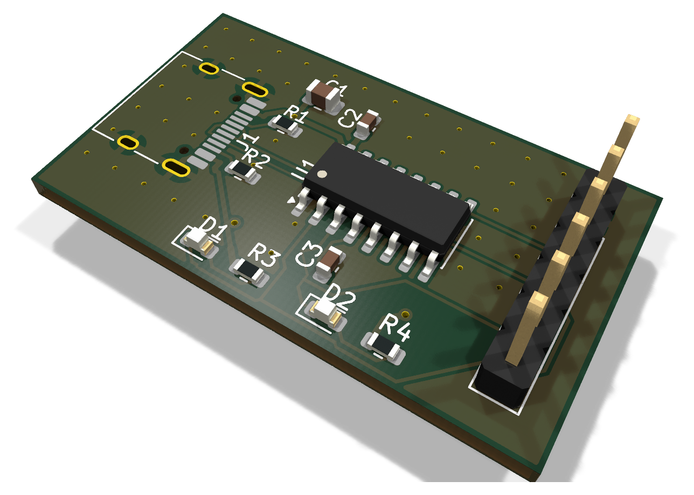
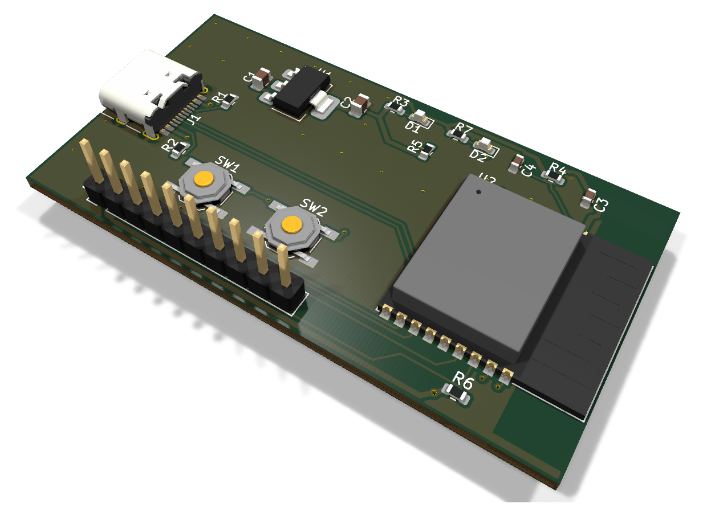

# Benchmarks

What it costs to go from a sentence to a board, measured on real Claude Code sessions rather than estimated.
Each run is one prompt, no help along the way, logged with `claude -p --output-format stream-json` and turned into a
report by [`scripts/session_report.py`](../scripts/session_report.py).

## CH340C USB-C to UART adapter

<p align="center"></p>

> Design a small USB-C to UART adapter around the CH340C, like an FTDI cable but as a board: 5 V from USB-C, TX and RX activity LEDs, and a 6-pin 2.54 mm FTDI-style header (GND, CTS, VCC, TXD, RXD, DTR). Keep it about 35 x 20 mm, two layers, JLCPCB assembly with basic parts where possible. Put the project in this folder as ch340, take it to a DRC-clean board and export the fab files.

| Run | Prompts | Turns | Tool calls | of which part searches | Tokens read | Tokens written | Cost | Time | Result |
| --- | ---: | ---: | ---: | ---: | ---: | ---: | ---: | ---: | --- |
| First attempt | 1 | 67 | 65 | 29 | 1,621,402 | 23,404 | $0.66 | 3 min 59 s | stopped: stale tracks after moving parts, 28 DRC errors |
| **After the fixes** | 1 | 50 | 48 | 11 | 1,501,640 | 16,637 | $0.51 | 3 min 6 s | **DRC clean, fab files exported** |

Model `claude-sonnet-5-5` for both. "Tokens read" counts every call's full context again, so it adds up fast; about
97 % of it was served from the prompt cache at a tenth of the price, which is why the whole board cost about fifty cents.

### What the first attempt found

The first run did what a person would do: it routed the board, saw courtyard errors around the LEDs, moved four parts
and routed again. The old tracks were handed to Freerouting as fixed wiring, so they stayed where the parts used to be:
shorts, 28 DRC errors, and no tool to remove them. It stopped and asked for permission to edit the board by other means.
It had also spent 29 of its 65 tool calls on part search, because jlcsearch reports no stock for basic parts and the
search dropped every one of them.

Both were fixed before the second run (commit `8f76692`): `autoroute` now rips up unlocked tracks before routing,
`add_copper_zone` replaces an old pour, and part search keeps basic parts and looks values up by value.

```mermaid
xychart-beta
    title "Tool calls per tool: first attempt (left bar) vs. after the fixes (right bar)"
    x-axis ["search_parts", "run_drc", "get_symbol", "get_footprint", "find_symbol", "add_copper_zone", "autoroute", "place_footprints", "sync_design", "find_footprint", "ToolSearch", "Bash", "set_netclass", "render_board", "board_summary", "Read", "Skill", "export_fab"]
    y-axis "calls" 0 --> 31
    bar [29, 3, 4, 5, 4, 1, 2, 4, 3, 2, 2, 3, 1, 0, 1, 0, 1, 0]
    bar [11, 5, 4, 3, 2, 5, 4, 2, 1, 2, 1, 0, 1, 2, 1, 2, 1, 1]
```



Full step-by-step report of the clean run, with the context curve and every tool call:
[examples/ch340-usb-uart/SESSION.md](../examples/ch340-usb-uart/SESSION.md).

## ESP32-C3 USB-C dev board

<p align="center"></p>

This one was not made from a prompt: [`build.py`](../examples/esp32c3-devboard/build.py) calls the same tools in the
order the agent would (sync, place, netclass, autoroute, pour, DRC, fab) with a hand-written placement, so it uses no
model tokens. It is the reproducible reference board and the source of the README images.

| Steps | Parts | Nets | Board | Result |
| ---: | ---: | ---: | --- | --- |
| 8 tool calls (a few more when Freerouting needs a second try) | 19 | 19 | 60 × 32 mm, 2 layers | DRC clean, fab files exported |

## Reproduce

```bash
cd examples/ch340-usb-uart && mkdir run && cd run
claude -p "$(cat ../PROMPT.txt)" --append-system-prompt "$(cat ../APPENDED_INSTRUCTION.txt)" \
  --plugin-dir <path-to-tamga-pcb> --permission-mode acceptEdits \
  --allowedTools mcp__plugin_tamga-pcb_tamga Read Write Edit Glob Grep "Bash(ls:*)" \
  --output-format stream-json --verbose > session.jsonl
uv run --directory <path-to-tamga-pcb> python scripts/session_report.py session.jsonl . --prompt-file ../PROMPT.txt
```

The appended instruction only tells Claude not to pause for approval (the author's own setup asks it to); drop it if
yours doesn't. Freerouting and the model are not deterministic, so turns, tokens and the exact tracks vary from run to run.
