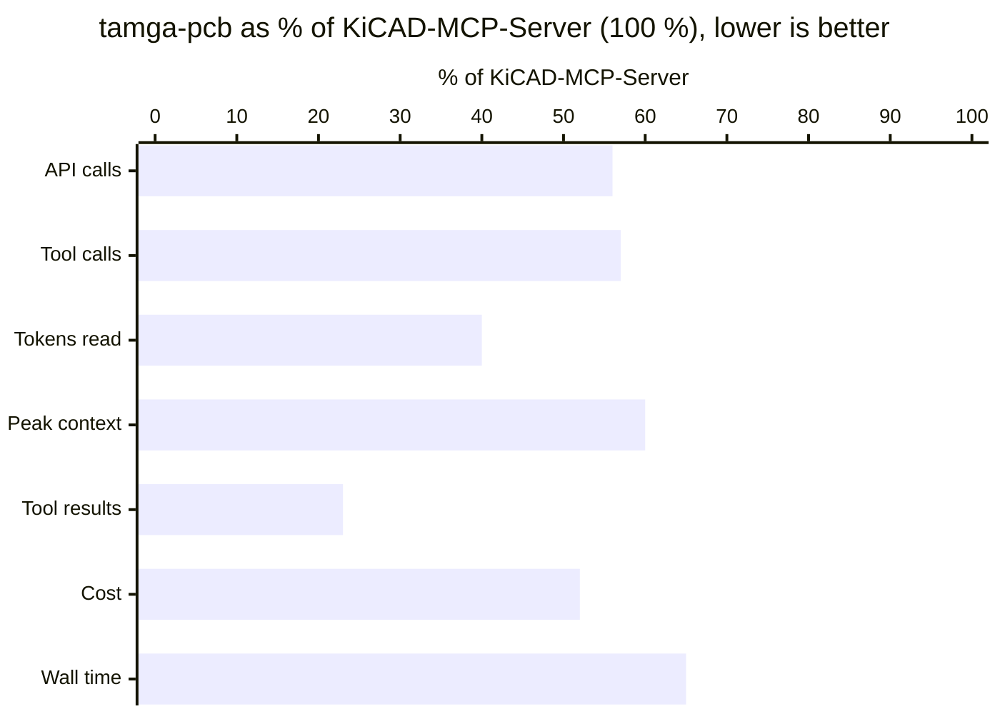

# Benchmarks

What it costs to go from a sentence to a board, measured on real Claude Code sessions rather than estimated.
Each run is one prompt, no help along the way, logged with `claude -p --output-format stream-json` and turned into a
report by [`scripts/session_report.py`](../scripts/session_report.py).

## CH340C USB-C to UART adapter

<p align="center"></p>

> Design a small USB-C to UART adapter around the CH340C, like an FTDI cable but as a board: 5 V from USB-C, TX and RX activity LEDs, and a 6-pin 2.54 mm FTDI-style header (GND, CTS, VCC, TXD, RXD, DTR). Keep it about 35 x 20 mm, two layers, JLCPCB assembly with basic parts where possible. Put the project in this folder as ch340, take it to a DRC-clean board and export the fab files.

| Run | Prompts | Turns | Tool calls | of which part searches | Tokens read | Tokens written | Cost | Time | Result |
| --- | ---: | ---: | ---: | ---: | ---: | ---: | ---: | ---: | --- |
| First attempt | 1 | 67 | 65 | 29 | 1,621,402 | 23,404 | $0.66 | 3 min 59 s | stopped: stale tracks after moving parts, 28 DRC errors |
| **After the fixes** | 1 | 50 | 48 | 11 | 1,501,640 | 16,637 | $0.51 | 3 min 6 s | **DRC clean, fab files exported** |
| After the scope expansion (21 tools, same prompt, Sonnet pinned) | 1 | 55 | 53 | 10 | 1,827,472 | 19,365 | $0.63 | 5 min 5 s | DRC clean, fab files exported |

Model `claude-sonnet-5-5` for both. "Tokens read" counts every call's full context again, so it adds up fast; about
97 % of it was served from the prompt cache at a tenth of the price, which is why the whole board cost about fifty cents.

The third row was measured after adding board shapes, 4/6 layers, impedance, differential pairs and `create_part` (tool schemas 13.3k → 16.1k characters): 31 API calls and $0.63 against 28 and $0.51. It called `sync_design` 7 times instead of once while settling the parts, which doubled the tool output. With one run each it is not yet clear how much of that is the larger tool set and how much is run-to-run variation; it is still well under KiCAD-MCP-Server's 50 calls and $0.98. Raw numbers: [data/tamga-pcb-21-tools-sonnet.json](data/tamga-pcb-21-tools-sonnet.json).

### What the first attempt found

The first run did what a person would do: it routed the board, saw courtyard errors around the LEDs, moved four parts
and routed again. The old tracks were handed to Freerouting as fixed wiring, so they stayed where the parts used to be:
shorts, 28 DRC errors, and no tool to remove them. It stopped and asked for permission to edit the board by other means.
It had also spent 29 of its 65 tool calls on part search, because jlcsearch reports no stock for basic parts and the
search dropped every one of them.

Both were fixed before the second run (commit `8f76692`): `autoroute` now rips up unlocked tracks before routing,
`add_copper_zone` replaces an old pour, and part search keeps basic parts and looks values up by value.

```mermaid
xychart-beta
    title "Tool calls per tool: first attempt (left bar) vs. after the fixes (right bar)"
    x-axis ["search_parts", "run_drc", "get_symbol", "get_footprint", "find_symbol", "add_copper_zone", "autoroute", "place_footprints", "sync_design", "find_footprint", "ToolSearch", "Bash", "set_netclass", "render_board", "board_summary", "Read", "Skill", "export_fab"]
    y-axis "calls" 0 --> 31
    bar [29, 3, 4, 5, 4, 1, 2, 4, 3, 2, 2, 3, 1, 0, 1, 0, 1, 0]
    bar [11, 5, 4, 3, 2, 5, 4, 2, 1, 2, 1, 0, 1, 2, 1, 2, 1, 1]
```



Full step-by-step report of the clean run, with the context curve and every tool call:
[examples/ch340-usb-uart/SESSION.md](../examples/ch340-usb-uart/SESSION.md).

## Against another KiCad MCP server

Same prompt, same model (`claude-sonnet-5-5`, pinned with `--model`), same appended instruction, same Freerouting
2.5.0 jar, same machine and the same unrelated connectors loaded. The only difference is the KiCad tooling: the
tamga-pcb plugin, or [mixelpixx/KiCAD-MCP-Server](https://github.com/mixelpixx/KiCAD-MCP-Server) (v2.9.0, commit
`aa7dfe0`, the most-starred KiCad MCP server, built from source and connected with `--mcp-config`). Both boards were
re-checked with KiCad's DRC afterwards.

| | tamga-pcb | KiCAD-MCP-Server | |
| --- | ---: | ---: | --- |
| Cost (API list price) | **$0.51** | $0.98 | 48 % less |
| Tokens read (all calls) | **1,501,640** | 3,743,343 | 60 % less |
| Tokens written | **16,637** | 24,256 | 31 % less |
| Largest context in one call | **64,345** | 106,806 | 40 % less |
| Context at the start | 26,328 | 24,959 | about the same |
| API calls | **28** | 50 | 44 % less |
| Tool calls | **48** (0 errors) | 84 (5 errors: 2 blocked shell commands, 2 invalid tool arguments, 1 failed direct edit of a KiCad file) | 43 % less |
| All tool results together | **16,785 chars** | 71,997 chars | 77 % less |
| Wall time | **3 min 06 s** | 4 min 48 s | 35 % less |
| Result | DRC clean, fab files | DRC clean, fab files | both finished |
| LCSC numbers | looked up in JLC's catalogue | from memory (local parts DB not downloaded) |  |



Each bar is tamga-pcb's number divided by KiCAD-MCP-Server's, from the table above.

**What this does and doesn't show**
- Both tools got the job done; KiCAD-MCP-Server covers far more of KiCad (229 tools: hierarchical sheets, symbol
  creation, IPC-2581 and ODB++ export, an experimental live-editing backend…). This measures one thing: the same small board, end to end, unattended.
- Its 258 registered tool schemas are about 288k characters against tamga-pcb's 13k, but Claude Code defers MCP tools
  until they are needed, so both sessions **start** at about 25k tokens. The gap opens during the work: tamga-pcb's
  answers are shorter (about 350 characters per call against about 860) and the job takes fewer calls, and every
  call re-reads everything before it.
- Its JLCPCB part search needs a local database download (`download_jlcpcb.py`) that was not run, so it chose LCSC
  numbers from memory; with the database its run would have looked different, in calls and in part choice.
- One run each, which is a measurement, not a statistic: models and Freerouting are not deterministic, and a
  second run of either would give different numbers.
- With `claude-opus-5-5` (its first run, before the model was pinned) KiCAD-MCP-Server took 36 API calls,
  56 tool calls and $1.44, finishing with 0 DRC errors and 2 silkscreen warnings.

Raw numbers: [tamga-pcb](../examples/ch340-usb-uart/session-metrics.json),
[KiCAD-MCP-Server, Sonnet](data/kicad-mcp-server-sonnet.json), [KiCAD-MCP-Server, Opus](data/kicad-mcp-server-opus.json).

## ESP32-C3 USB-C dev board

<p align="center"></p>

This one was not made from a prompt: [`build.py`](../examples/esp32c3-devboard/build.py) calls the same tools in the
order the agent would (sync, place, netclass, autoroute, pour, DRC, fab) with a hand-written placement, so it uses no
model tokens. It is the reproducible reference board and the source of the README images.

| Steps | Parts | Nets | Board | Result |
| ---: | ---: | ---: | --- | --- |
| 8 tool calls (a few more when Freerouting needs a second try) | 19 | 19 | 60 × 32 mm, 2 layers | DRC clean, fab files exported |

## Reproduce

```bash
cd examples/ch340-usb-uart && mkdir run && cd run
claude -p "$(cat ../PROMPT.txt)" --append-system-prompt "$(cat ../APPENDED_INSTRUCTION.txt)" \
  --plugin-dir <path-to-tamga-pcb> --permission-mode acceptEdits \
  --allowedTools mcp__plugin_tamga-pcb_tamga Read Write Edit Glob Grep "Bash(ls:*)" \
  --output-format stream-json --verbose > session.jsonl
uv run --directory <path-to-tamga-pcb> python scripts/session_report.py session.jsonl . --prompt-file ../PROMPT.txt
```

The appended instruction only tells Claude not to pause for approval (the author's own setup asks it to); drop it if
yours doesn't. Freerouting and the model are not deterministic, so turns, tokens and the exact tracks vary from run to run.
