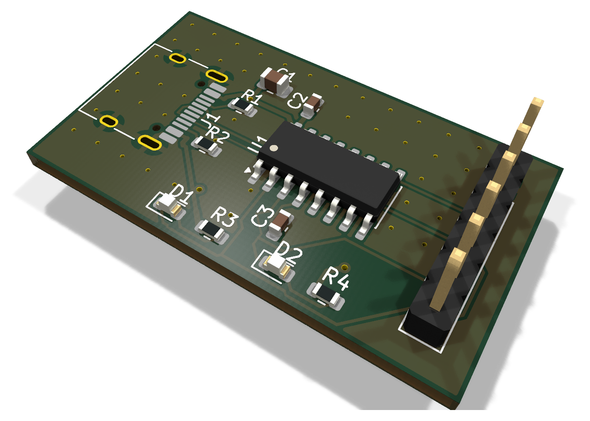
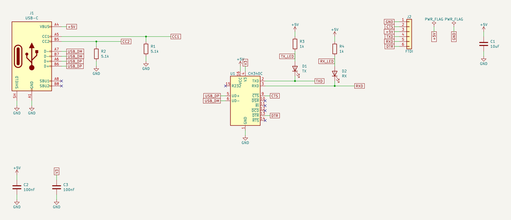

# CH340C USB-C to UART adapter

Made by Claude Code from **one prompt** ([`PROMPT.txt`](PROMPT.txt)), with no help along the way: 35 × 20 mm, two
layers, CH340C, USB-C, TX/RX LEDs and an FTDI-style 6-pin header. DRC clean, Gerbers, BOM and CPL exported.
**3 minutes, about $0.51** with `claude-sonnet-5-5`. The full measured report, with token charts and every tool call,
is in [SESSION.md](SESSION.md); the comparison with the first attempt is in [docs/BENCHMARKS.md](../../docs/BENCHMARKS.md).

## Files

| File | What it is |
| --- | --- |
| [`PROMPT.txt`](PROMPT.txt) | The prompt, verbatim |
| [`APPENDED_INSTRUCTION.txt`](APPENDED_INSTRUCTION.txt) | Added to the system prompt so the run is unattended (see SESSION.md) |
| [`ch340/ch340.circuit.json`](ch340/ch340.circuit.json) | The spec Claude wrote |
| `ch340/ch340.kicad_sch`, `ch340/ch340.kicad_pcb` | Generated schematic and the routed, poured board |
| [`SESSION.md`](SESSION.md), [`session-metrics.json`](session-metrics.json) | Measured report and raw numbers |
| [`first-attempt-metrics.json`](first-attempt-metrics.json) | The run that found two bugs, before they were fixed |

The schematic was regenerated once after the run, when the generator learned to use labels for power pins on crowded
connectors; the board, the spec and all numbers are the session's own.

Before ordering, Claude itself asks you to check two things in JLC's viewer: the LED polarity (the LCSC part numbers
its pads the other way round from KiCad's LED symbol, which `sync_design` also warns about) and the CPL rotations.
