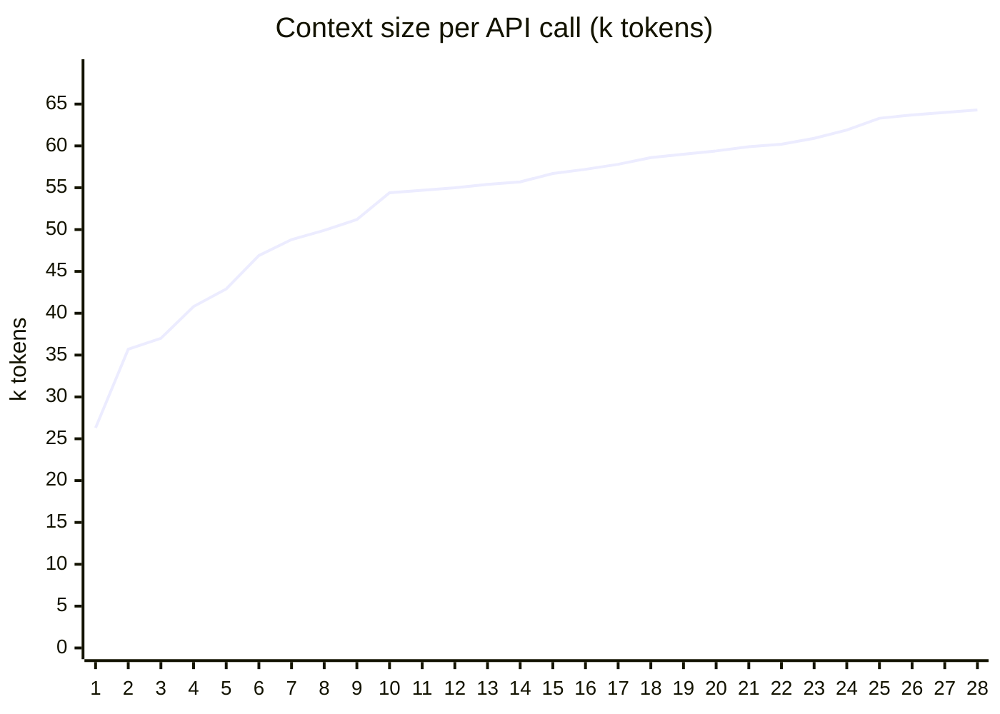
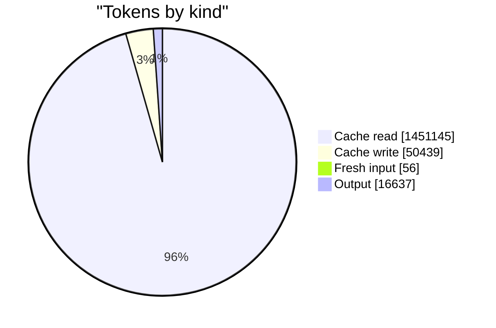
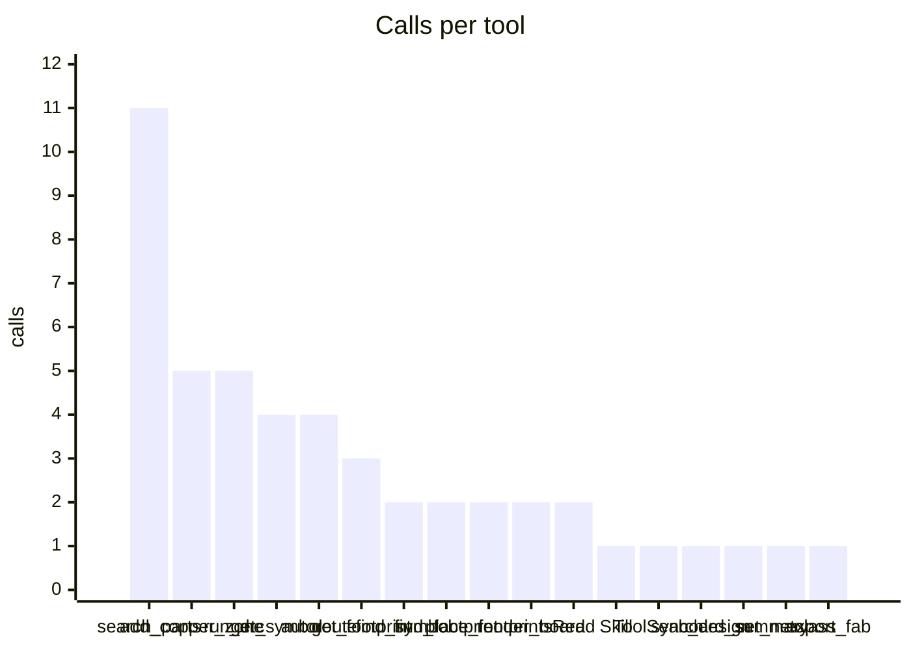

# CH340C USB-C to UART adapter: one prompt to fab files

Measured from a real, unattended Claude Code session: one prompt in, a DRC-clean board and fab files out.
Numbers come from the session's own `stream-json` log, turned into this page by [`scripts/session_report.py`](../../scripts/session_report.py).

## The prompt

> Design a small USB-C to UART adapter around the CH340C, like an FTDI cable but as a board: 5 V from USB-C, TX and RX activity LEDs, and a 6-pin 2.54 mm FTDI-style header (GND, CTS, VCC, TXD, RXD, DTR). Keep it about 35 x 20 mm, two layers, JLCPCB assembly with basic parts where possible. Put the project in this folder as ch340, take it to a DRC-clean board and export the fab files.

## At a glance

| | |
| --- | --- |
| Prompts from the user | **1** |
| Model | `claude-sonnet-5-5` |
| Agent turns | 50 |
| API calls | 28 |
| Tool calls | 48 (0 returned an error) |
| Wall time | 3 min 6 s |
| Tokens read (input + cache) | 1,501,640 |
| of which served from cache | 1,451,145 (97 %) |
| Tokens written (output) | 16,637 |
| Largest context in a single call | 64,345 tokens |
| API cost (list price) | $0.51 |

## Context per API call

How much the model had in front of it at each step, in thousand tokens. It starts at 26.3k (system prompt, tools, skill) and grows by about 1.4k per call, because tools answer with one-line summaries instead of KiCad files. Each call re-reads the whole context, which is why the total above runs into millions; almost all of it comes from the prompt cache at a tenth of the price.

## Where the tokens went

## Tool calls

| Tool | Calls | Result size, total | per call |
| --- | ---: | ---: | ---: |
| `search_parts` | 11 | 2,990 chars | 272 |
| `add_copper_zone` | 5 | 1,016 chars | 203 |
| `run_drc` | 5 | 1,837 chars | 367 |
| `get_symbol` | 4 | 2,346 chars | 586 |
| `autoroute` | 4 | 1,205 chars | 301 |
| `get_footprint` | 3 | 2,194 chars | 731 |
| `find_symbol` | 2 | 576 chars | 288 |
| `find_footprint` | 2 | 872 chars | 436 |
| `place_footprints` | 2 | 406 chars | 203 |
| `render_board` | 2 | 195 chars | 98 |
| `Read` | 2 | 0 chars | 0 |
| `Skill` | 1 | 37 chars | 37 |
| `ToolSearch` | 1 | 0 chars | 0 |
| `sync_design` | 1 | 1,391 chars | 1,391 |
| `board_summary` | 1 | 1,215 chars | 1,215 |
| `set_netclass` | 1 | 180 chars | 180 |
| `export_fab` | 1 | 325 chars | 325 |

## Step by step

Every tool call, in order

| # | Tool | Input (start) | Result (start) |
| ---: | --- | --- | --- |
| 1 | `Skill` | {"skill": "tamga-pcb:pcb-design"} | Launching skill: tamga-pcb:pcb-design |
| 2 | `ToolSearch` | {"query": "select:mcp__plugin_tamga-pcb_tamga__find_symbol,mcp__plugin_tamga-pcb_tamga__get_symbol,mcp__plugin_tamga-pcb_tamga__search_parts,mcp__plugin_tamga-p |  |
| 3 | `find_symbol` | {"query": "CH340C"} | {"symbols":["Interface_USB:CH340C \| USB serial converter, crystal-less, UART, SOIC-16 \| fp=Package_SO:SOIC-16_3.9x9.9mm_P1.27mm"]} |
| 4 | `find_symbol` | {"query": "USB_C_Receptacle"} | {"symbols":["Connector:USB_C_Receptacle \| USB Full-Featured Type-C Receptacle connector","Connector:USB_C_Receptacle_USB2.0_14P \| USB 2.0-only 14P Type-C Recept |
| 5 | `search_parts` | {"query": "CH340C"} | {"query":"CH340C","legend":"B=basic (no setup fee), P=preferred, E=extended (+$3 setup)","parts":[],"shown":0,"matched":0,"hint":"no match in jlcsearch (its cat |
| 6 | `search_parts` | {"query": "USB Type-C 16P receptacle"} | {"query":"USB Type-C 16P receptacle","legend":"B=basic (no setup fee), P=preferred, E=extended (+$3 setup)","parts":[],"shown":0,"matched":0,"hint":"no match in |
| 7 | `find_footprint` | {"query": "PinHeader 1x06 2.54 horizontal"} | {"footprints":["Connector_PinHeader_2.54mm:PinHeader_1x06_P2.54mm_Horizontal"]} |
| 8 | `search_parts` | {"query": "C84681"} | {"query":"C84681","legend":"B=basic (no setup fee), P=preferred, E=extended (+$3 setup)","parts":["C84681 [E] CH340C \| SOP-16 \| stock ? \| $0.5857 \| -20℃~+70℃ 2M |
| 9 | `search_parts` | {"query": "C165948"} | {"query":"C165948","legend":"B=basic (no setup fee), P=preferred, E=extended (+$3 setup)","parts":["C165948 [E] TYPE-C-31-M-12 \| SMD \| stock ? \| $0.1858 \| -30℃~ |
| 10 | `search_parts` | {"query": "5.1k 1%", "package": "0603", "basic_only": true, "limit": 3} | {"query":"5.1k 1%","legend":"B=basic (no setup fee), P=preferred, E=extended (+$3 setup)","parts":["C23186 [B] 0603WAF5101T5E \| 0603 \| stock ? \| $0.0019 \| -55℃~ |
| 11 | `search_parts` | {"query": "1k 1%", "package": "0603", "basic_only": true, "limit": 3} | {"query":"1k 1%","legend":"B=basic (no setup fee), P=preferred, E=extended (+$3 setup)","parts":["C21190 [B] 0603WAF1001T5E \| 0603 \| stock ? \| $0.0039 \| -55℃~+1 |
| 12 | `search_parts` | {"query": "100nF", "package": "0603", "basic_only": true, "limit": 3} | {"query":"100nF","legend":"B=basic (no setup fee), P=preferred, E=extended (+$3 setup)","parts":["C14663 [B] CC0603KRX7R9BB104 \| 0603 \| stock ? \| $0.0106 \| 100n |
| 13 | `search_parts` | {"query": "LED green", "package": "0603", "basic_only": true, "limit": 3} | {"query":"LED green","legend":"B=basic (no setup fee), P=preferred, E=extended (+$3 setup)","parts":[],"shown":0,"matched":0,"hint":"no match in jlcsearch (its  |
| 14 | `search_parts` | {"query": "LED red", "package": "0603", "basic_only": true, "limit": 3} | {"query":"LED red","legend":"B=basic (no setup fee), P=preferred, E=extended (+$3 setup)","parts":["C2286 [B] KT-0603R \| 0603 \| stock 8476798 \| $0.0073 \| -40℃~+ |
| 15 | `search_parts` | {"query": "10uF", "package": "0805", "basic_only": true, "limit": 3} | {"query":"10uF","legend":"B=basic (no setup fee), P=preferred, E=extended (+$3 setup)","parts":["C15850 [B] CL21A106KAYNNNE \| 0805 \| stock ? \| $0.0773 \| 10uF 25 |
| 16 | `get_symbol` | {"lib_id": "Interface_USB:CH340C", "footprint": "Package_SO:SOIC-16_3.9x9.9mm_P1.27mm", "lcsc": "C84681"} | {"lib_id":"Interface_USB:CH340C","description":"USB serial converter, crystal-less, UART, SOIC-16","units":1,"pins":["1:GND:power_in","2:TXD:output","3:RXD:inpu |
| 17 | `find_footprint` | {"query": "USB_C_Receptacle"} | {"footprints":["Connector_USB:USB_C_Receptacle_GCT_USB4085","Connector_USB:USB_C_Receptacle_GCT_USB4110","Connector_USB:USB_C_Receptacle_Palconn_UTC16-G","Conne |
| 18 | `get_symbol` | {"lib_id": "Connector:USB_C_Receptacle_USB2.0_16P", "footprint": "Connector_USB:USB_C_Receptacle_HRO_TYPE-C-31-M-12", "lcsc": "C165948"} | {"lib_id":"Connector:USB_C_Receptacle_USB2.0_16P","description":"USB 2.0-only 16P Type-C Receptacle connector","units":1,"pins":["A1:GND:passive","A4:VBUS:passi |
| 19 | `search_parts` | {"query": "C72043"} | {"query":"C72043","legend":"B=basic (no setup fee), P=preferred, E=extended (+$3 setup)","parts":["C72043 [E] 19-217/GHC-YR1S2/3T \| 0603 \| stock ? \| $0.0445 \| - |
| 20 | `get_symbol` | {"lib_id": "Device:LED", "footprint": "LED_SMD:LED_0603_1608Metric"} | {"lib_id":"Device:LED","description":"Light emitting diode","units":1,"pins":["1:K:passive","2:A:passive"],"fp_filters":"LED* LED_SMD:* LED_THT:*","footprint_pa |
| 21 | `get_symbol` | {"lib_id": "Connector_Generic:Conn_01x06", "footprint": "Connector_PinHeader_2.54mm:PinHeader_1x06_P2.54mm_Horizontal"} | {"lib_id":"Connector_Generic:Conn_01x06","description":"Generic connector, single row, 01x06, script generated (kicad-library-utils/schlib/autogen/connector/)", |
| 22 | `sync_design` | {"project_dir": "<project>/ch340", "name": "ch340", "spec": {"title": "CH340C USB-C UART adapter", "board": {"width_mm": 35, "height_mm": 20}, "parts": [{"ref": | {"files":{"spec":"<project>/ch340/ch340.circuit.json","sch":"<project>/ch340/ch340.kicad_sch","pcb":"<project>/ch340/ch340.kicad_pcb"},"parts":12,"nets":"+5V:10 |
| 23 | `board_summary` | {"pcb_path": "<project>/ch340/ch340.kicad_pcb"} | {"file":"ch340.kicad_pcb","size_mm":[35.1,20.1],"origin_mm":[99.95,99.95],"copper_layers":2,"counts":{"footprints":12,"nets":13,"tracks":0,"vias":0,"zones":0}," |
| 24 | `get_footprint` | {"pcb_path": "<project>/ch340/ch340.kicad_pcb", "ref": "J1"} | {"line":"J1 USB-C USB_C_Receptacle_HRO_TYPE-C-31-M-12 @(107.295,107.245) r0 F","bbox_mm":[101.95,101.95,10.69,9.47],"pads":[":-@(104.405,104.645)",":-@(110.185, |
| 25 | `place_footprints` | {"pcb_path": "<project>/ch340/ch340.kicad_pcb", "moves": [{"ref": "J1", "x": 106, "y": 110, "rot": 90}, {"ref": "J2", "x": 131.5, "y": 103.75, "rot": 0}, {"ref" | {"moved":["J1","J2","U1"],"errors":[],"backup":"<project>/ch340/.tamga_backups/20261122-213635-ch340.kicad_pcb","unrouted":34} |
| 26 | `get_footprint` | {"pcb_path": "<project>/ch340/ch340.kicad_pcb", "ref": "J1"} | {"line":"J1 USB-C USB_C_Receptacle_HRO_TYPE-C-31-M-12 @(106.0,110.0) r90 F","bbox_mm":[100.705,104.655,9.47,10.69],"pads":[":-@(103.4,112.89)",":-@(103.4,107.11 |
| 27 | `get_footprint` | {"pcb_path": "<project>/ch340/ch340.kicad_pcb", "ref": "U1"} | {"line":"U1 CH340C SOIC-16_3.9x9.9mm_P1.27mm @(119.0,110.0) r90 F","bbox_mm":[113.6,106.275,10.625,7.45],"pads":["1:GND@(114.555,112.475)","2:TXD@(115.825,112.4 |
| 28 | `place_footprints` | {"pcb_path": "<project>/ch340/ch340.kicad_pcb", "moves": [{"ref": "J1", "x": 104.2, "y": 110, "rot": 270}, {"ref": "U1", "x": 120.5, "y": 110, "rot": 90}, {"ref | {"moved":["J1","U1","C2","C3","C1","R1","R2","D1","R3","D2","R4"],"errors":[],"backup":"<project>/ch340/.tamga_backups/20261122-213700-ch340.kicad_pcb","unroute |
| 29 | `set_netclass` | {"pcb_path": "<project>/ch340/ch340.kicad_pcb", "name": "POWER", "nets": ["+5V", "GND"], "track_mm": 0.4, "via_mm": 0.8, "via_drill_mm": 0.4} | {"netclass":"POWER(t0.4,c0.2,v0.8/0.4): +5V GND","backup":"<project>/ch340/.tamga_backups/20261122-213701-ch340.kicad_pcb"} |
| 30 | `autoroute` | {"pcb_path": "<project>/ch340/ch340.kicad_pcb"} | {"out":"<project>/ch340/ch340.kicad_pcb","unrouted_before":34,"unrouted_after":0,"tracks":135,"vias":7,"freerouting":"2 routing + 2 optimizer passes in 5s","not |
| 31 | `add_copper_zone` | {"pcb_path": "<project>/ch340/ch340.kicad_pcb"} | {"zone":"GND on F.Cu+B.Cu","stitch_vias":13,"backup":"<project>/ch340/.tamga_backups/20261122-213710-ch340.kicad_pcb","unrouted":0} |
| 32 | `run_drc` | {"pcb_path": "<project>/ch340/ch340.kicad_pcb", "schematic_parity": true} | {"total":1,"errors":1,"warnings":0,"types":[{"type":"starved_thermal","severity":"error","count":1,"what":"Thermal relief connection to zone incomplete (layer B |
| 33 | `render_board` | {"pcb_path": "<project>/ch340/ch340.kicad_pcb", "side": "bottom"} | {"png":"<project>/ch340/ch340_bottom.png"} |
| 34 | `Read` | {"file_path": "<project>/ch340/ch340_bottom.png"} |  |
| 35 | `add_copper_zone` | {"pcb_path": "<project>/ch340/ch340.kicad_pcb", "stitch_pitch_mm": 3} | {"zone":"GND on F.Cu+B.Cu","replaced_zones":2,"stitch_vias":28,"backup":"<project>/ch340/.tamga_backups/20261122-213723-ch340.kicad_pcb","unrouted":0} |
| 36 | `run_drc` | {"pcb_path": "<project>/ch340/ch340.kicad_pcb", "schematic_parity": true} | {"total":5,"errors":1,"warnings":4,"types":[{"type":"starved_thermal","severity":"error","count":1,"what":"Thermal relief connection to zone incomplete (layer B |
| 37 | `autoroute` | {"pcb_path": "<project>/ch340/ch340.kicad_pcb"} | {"out":"<project>/ch340/ch340.kicad_pcb","unrouted_before":0,"unrouted_after":1,"tracks":110,"vias":3,"freerouting":"4 routing + 4 optimizer passes in 5s","ripp |
| 38 | `add_copper_zone` | {"pcb_path": "<project>/ch340/ch340.kicad_pcb", "stitch_pitch_mm": 4} | {"zone":"GND on F.Cu+B.Cu","replaced_zones":2,"stitch_vias":27,"backup":"<project>/ch340/.tamga_backups/20261122-213741-ch340.kicad_pcb","unrouted":2} |
| 39 | `run_drc` | {"pcb_path": "<project>/ch340/ch340.kicad_pcb", "schematic_parity": true, "max_examples": 6} | {"total":2,"errors":2,"warnings":0,"types":[{"type":"unconnected_items","severity":"error","count":2,"what":"Missing connection between items","nets":["GND"],"e |
| 40 | `autoroute` | {"pcb_path": "<project>/ch340/ch340.kicad_pcb"} | {"out":"<project>/ch340/ch340.kicad_pcb","unrouted_before":2,"unrouted_after":3,"tracks":110,"vias":3,"freerouting":"4 routing + 4 optimizer passes in 5s","ripp |
| 41 | `add_copper_zone` | {"pcb_path": "<project>/ch340/ch340.kicad_pcb", "stitch_pitch_mm": 3} | {"zone":"GND on F.Cu+B.Cu","replaced_zones":2,"stitch_vias":27,"backup":"<project>/ch340/.tamga_backups/20261122-213756-ch340.kicad_pcb","unrouted":2} |
| 42 | `run_drc` | {"pcb_path": "<project>/ch340/ch340.kicad_pcb", "max_examples": 6} | {"total":2,"errors":2,"warnings":0,"types":[{"type":"unconnected_items","severity":"error","count":2,"what":"Missing connection between items","nets":["GND"],"e |
| 43 | `render_board` | {"pcb_path": "<project>/ch340/ch340.kicad_pcb"} | {"png":"<project>/ch340/ch340_top.png"} |
| 44 | `Read` | {"file_path": "<project>/ch340/ch340_top.png"} |  |
| 45 | `autoroute` | {"pcb_path": "<project>/ch340/ch340.kicad_pcb"} | {"out":"<project>/ch340/ch340.kicad_pcb","unrouted_before":2,"unrouted_after":3,"tracks":110,"vias":3,"freerouting":"4 routing + 4 optimizer passes in 5s","ripp |
| 46 | `add_copper_zone` | {"pcb_path": "<project>/ch340/ch340.kicad_pcb", "stitch_pitch_mm": 2.5, "clearance_mm": 0.2} | {"zone":"GND on F.Cu+B.Cu","replaced_zones":2,"stitch_vias":45,"backup":"<project>/ch340/.tamga_backups/20261122-213824-ch340.kicad_pcb","unrouted":0} |
| 47 | `run_drc` | {"pcb_path": "<project>/ch340/ch340.kicad_pcb", "schematic_parity": true, "max_examples": 6} | {"total":0,"errors":0,"warnings":0,"types":[],"verdict":"CLEAN"} |
| 48 | `export_fab` | {"pcb_path": "<project>/ch340/ch340.kicad_pcb"} | {"dir":"<project>/ch340/fab","gerber_zip":"<project>/ch340/fab/ch340-gerbers.zip","files":29,"bom_lines":9,"missing_lcsc":["J2"],"note":"JLC rotations may need  |

## Claude's final message

CH340C USB-C to UART board is done: DRC is clean (0 errors, 0 warnings, schematic parity on), nothing is unrouted, and the fab files are exported. I did not check the CPL rotations or the LED polarity in JLC's viewer, so do both before ordering.

**What's on the board**
- It's 35.1 × 20.1 mm, two layers. USB-C sits on the left edge and the 6-pin header on the right, in the order GND, CTS, VCC, TXD, RXD, DTR.
- The header's TXD is the CH340's TXD, like an FTDI cable. The header's VCC is the 5 V from USB.
- 5 V and GND use 0.4 mm tracks. GND is poured on both layers with stitching vias.

**Choices I made without asking**
- The USB-C connector is C165948 (TYPE-C-31-M-12, 16-pin).
- Both LEDs are red (C2286, basic). The green one I found (C72043) is an extended part, so I avoided it.
- Each LED has a 1 k resistor from 5 V to its anode and the cathode on TXD or RXD. They light when the line goes low.
- The CH340C needs no crystal. It gets 100 nF on VCC, 100 nF on V3, and a 10 µF cap on 5 V. Two 5.1 k resistors on CC1 and CC2 make it a plain USB 2.0 device.
- The header is the vertical through-hole type, since a vertical header is the usual FTDI-style choice. JLC won't place it, so you solder it by hand, and it's the one BOM line with no LCSC code.
- To get the GND pour past DRC I set its clearance to 0.2 mm and the stitching pitch to 2.5 mm. This comes after a starved-thermal error on a USB shield pad and unconnected pour islands.

**Worth checking before ordering**
- **LED polarity:** the LCSC part's pin 1 and 2 are listed the opposite way round to the KiCad LED symbol. The footprint and CPL rotation decide the real orientation, so check D1 and D2 in JLC's 3D/CPL viewer, and check the other rotations there too.
- **Extended parts:** CH340C (C84681) and the USB-C connector (C165948) are both extended parts. Each adds a $3 setup fee at JLC.
- **Unrouted CC/D± pairs:** D+/D− were autorouted, not length-matched. That's fine for full-speed USB at this size.

**Files** are in `ch340-usb-uart/ch340/`. `ch340.circuit.json` is the editable source and `ch340.kicad_pcb` is the board. `fab/` has `ch340-gerbers.zip`, `BOM.csv` and `CPL.csv`.

## Environment

Claude Code 2.1.330, run headless with `claude -p` in the author's environment: 75 tools and 22 MCP servers were loaded (most of them unrelated connectors, kept deferred), so a clean install starts from a slightly smaller context. Only tamga-pcb tools and file read/write were allowed.

The author's global instructions ask Claude to pause for approval after every step; to measure an unattended run, this was appended to the system prompt (the user prompt above is unchanged):

> The user says: hızlı mod. Work autonomously to the end without pausing for approval or questions; make reasonable engineering choices yourself and list them in your final message.
