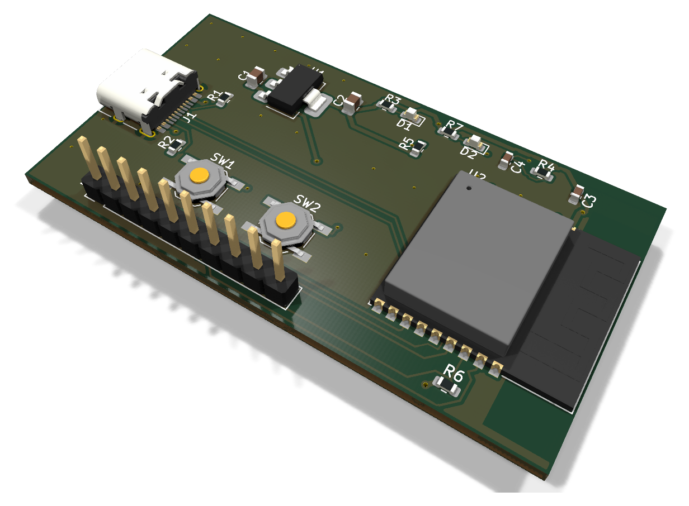

# ESP32-C3 USB-C dev board



A 60 × 32 mm, two-layer board made entirely through tamga-pcb's tools, the same calls Claude makes:

- **USB-C** sink (5.1 kΩ on CC1/CC2), native USB to the ESP32-C3 (IO18 = D−, IO19 = D+)
- **AMS1117-3.3** regulator with input/output capacitors and a power LED
- **ESP32-C3-WROOM-02** module, antenna flush with the board edge
- **Reset and boot** buttons, EN RC delay, IO2/IO8/IO9 strapping
- **10-pin header:** 3V3, GND, UART and five GPIOs, plus VBUS

Every part has a JLCPCB/LCSC number except the header (`missing_lcsc: J2`).

## Files

| File | What it is |
| --- | --- |
| [`esp32c3.circuit.json`](esp32c3.circuit.json) | The spec: the only file written by hand (by Claude) |
| `esp32c3*.kicad_sch` | Generated schematic: Power, MCU and IO sheets |
| `esp32c3.kicad_pcb` | Placed, routed, poured and DRC-clean board |
| [`build.py`](build.py) | Rebuilds everything above from the spec and renders the README images |

## Rebuild

From the repo root, with KiCad 10, Java 25+ and `uv sync --extra lcsc` done:

```bash
uv run python examples/esp32c3-devboard/build.py
```

It runs `sync_design → place_footprints → set_netclass → autoroute → add_copper_zone → run_drc → export_fab`
and stops if DRC is not clean. Freerouting is not deterministic, so the tracks differ from run to run; DRC is clean
either way. The fab package lands in `fab/` (Gerber zip, BOM.csv, CPL.csv).

Two things worth knowing:

- KiCad ships no 3D body for the HRO TYPE-C-31-M-12 USB-C connector, so the render borrows the GCT USB4105 body,
  which has the same outline and locating holes. This only affects the picture.
- `pinout_warnings` from `sync_design` for J1, U1 and the buttons are naming differences between KiCad and EasyEDA
  (merged `A1B12` pins, the regulator tab, the switch's extra pins). The check exists for the real mistakes: on the
  first try it caught a red LED whose LCSC part has pad 1 as the anode while KiCad's footprint has it as the
  cathode, and that LED was swapped for one that matches.
